# Card-Access Hotel Elevator

STM32 Nucleo-F411RE로 만든 **카드 권한형 3층 엘리베이터**입니다. 카드에 등록된 층으로만 갈 수 있는 카지노·호텔형 엘리베이터로,
스텝 모터로 카를 움직이고 포토인터럽터로 층을 감지하며, PC의 **Python GUI**와 UART로 카드 태그와 문 동작을 주고받습니다.

> Team 15 · 정명훈, 이기광 (2026.11)
>
> 📑 발표 자료: [docs/STM32_Elevator_Project.pdf](docs/STM32_Elevator_Project.pdf) · 개발계획서: [docs/elevator_dev_plan_v1.6.md](docs/elevator_dev_plan_v1.6.md)
> 🎬 동작 영상: [docs/video/demo_video.mp4](docs/video/demo_video.mp4) · GUI 영상: [docs/video/gui_video.mp4](docs/video/gui_video.mp4)

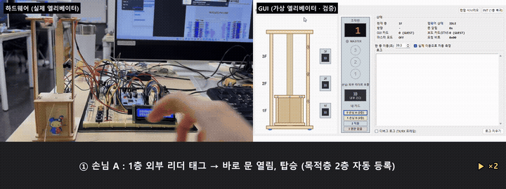

## System Overview

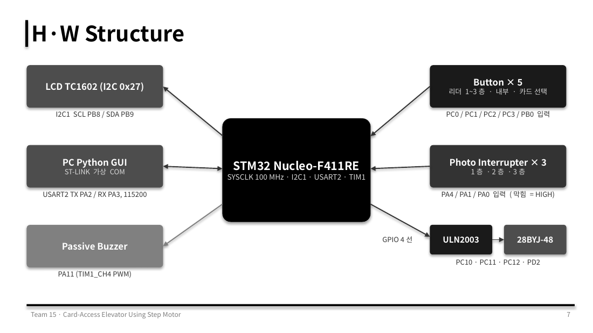

### System Flow

위 그림의 블록을 따라 엘리베이터 한 번의 운행이 이렇게 흘러갑니다.

1. **카드 태그 (Button × 5 / PC GUI → STM32)**
   보드 버튼(BTN1~3 외부 리더, BTN4 내부 리더, BTN5 카드 선택)이나 GUI의 카드 태그가 들어오면, `card_auth`가 카드 종류(손님 · 직원 · 권한 없음)와 리더 위치를 판단합니다. 권한 없는 카드는 응답 없이 무시합니다.
2. **요청 등록 (Scheduler)**
   손님 카드는 그 층 호출을 등록하고 목적층(1층 ↔ 2층)은 대기시켜 두었다가 탑승 순간에 자동 등록합니다. 직원 카드는 외부 리더에서는 호출만, 내부 리더에서는 **마스터 모드**(5초 안에 아무 층이나 1회 선택)로 들어갑니다. 요청은 8bit 레지스터(호출 bit0~3 · 목적층 bit4~6)에 모입니다.
3. **운행 판단 (Run FSM + SCAN)**
   `run_fsm`이 진행 방향을 우선으로 같은 방향의 요청을 한 번에 처리하고(SCAN), 위아래 요청이 없으면 방향을 바꿉니다.
4. **모터 구동 · 층 감지 (ULN2003 + 28BYJ-48 · Photo Interrupter × 3)**
   `motor_task()`가 3ms마다 하프스텝 한 칸씩 움직이고, 목표층 포토인터럽터(PA4/PA1/PA0)가 막히면 멈춥니다. 한 층 구간 30,000 스텝 안에 센서를 찾지 못하면 안전을 위해 정지합니다.
5. **문 핸드셰이크 (STM32 ↔ PC GUI, USART2 115200)**
   도착하면 `ARRIVED`를 보내고, GUI가 문을 연 뒤 `DOOR_OPENED`를 돌려주면 5초를 셉니다. 5초 후 `DOOR_CLOSE` → GUI가 문을 닫고 `DOOR_CLOSED`를 보내야 다음 층으로 출발합니다(인터록).
6. **표시 (LCD · Buzzer)**
   LCD(I2C 0x27) 1행에 `floor : n`, 문이 열려 있는 동안 2행에 `Closing in n sec`를 표시하고, 버튼과 GUI 입력마다 부저(TIM1 PWM)로 G6 → C7 두 음을 냅니다.

> **설계 원칙**: 모든 시간은 `HAL_GetTick()` 비교로 처리하고 FSM 안에 delay가 없습니다. 그래서 카가 이동 중이거나 문이 열려 있는 동안에도 카드와 GUI 입력을 계속 처리합니다. UART 수신 인터럽트는 프레임을 수신 큐(8칸)에 넣기만 하고, 처리는 메인 루프의 `rx_task()`가 합니다.

## 주요 기능

| 기능 | 동작 |
|---|---|
| **Card Access** | 카드 DB: 손님(2층), 직원(전 층), 권한 없음 · 외부 리더 태그 = 그 층 호출 · 손님 목적층은 태그 시점에 자동 등록(1층 ↔ 2층) · 권한 없는 카드는 무시 |
| **Master Mode** | 직원 카드로 내부 리더 태그 시 진입 · 5초 안에 층 버튼 1회 입력 · 입력 즉시 일반 모드 복귀 |
| **Run & Door** | 방향 우선, 같은 층 요청 한 번에 처리 · 포토인터럽터로 층 도착 정지 · 문 열림 5초 카운트를 LCD에 표시 · 문 닫힘 신호 전에는 출발 금지 |
| **Button / LCD / Buzzer** | BTN1~3(PC0~PC2) 1~3층 외부 리더 / 마스터 모드에서는 층 버튼 · BTN4(PC3) 내부 리더 · BTN5(PB0) 카드 선택 |

### Python GUI

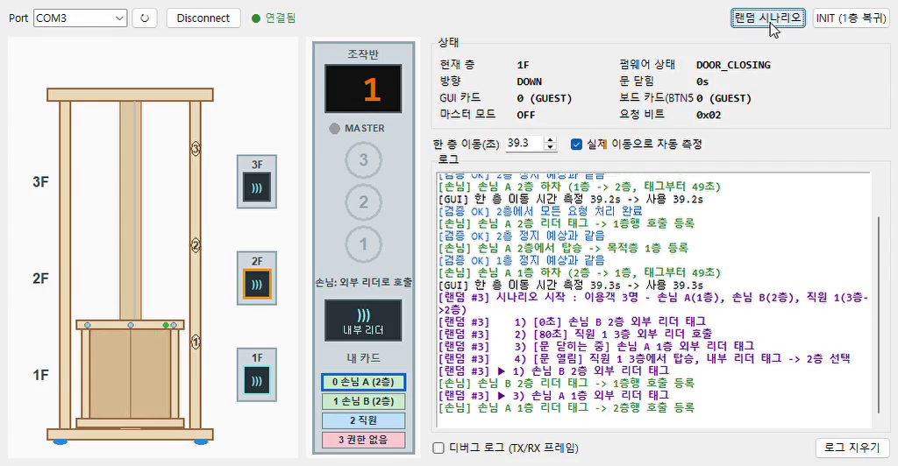

가상 엘리베이터와 문 애니메이션, 층별 카드 리더, 내부 조작반, 카드 선택, 펌웨어 상태(현재 층 · 방향 · 상태 · 요청 비트)를 보여 줍니다.
- **검증 모델** (`backend/model.py`): 펌웨어의 `scheduler.c` · `card_auth.c` · `master_mode.c`와 같은 운행 규칙을 Python으로 따로 돌려, STM32가 보낸 `ARRIVED` / `STATUS` / `DONE`이 예상과 다르면 로그에 알립니다.
- **랜덤 시나리오** (`backend/scenario.py`): 손님 · 직원 여러 명의 태그와 권한 없는 카드, 문 닫히는 중 같은 층 태그(REOPEN) 같은 방해 입력을 이동 중 · 문 열림 · 문 닫히는 중 타이밍에 흩어 넣어, 하드웨어로 만들기 어려운 상황을 시험합니다.
- **MOCK 모드**: 포트에서 `MOCK`을 고르면 보드 없이 가짜 펌웨어(`mock_fw.py`)로 GUI를 확인할 수 있습니다.

## 소프트웨어 구조

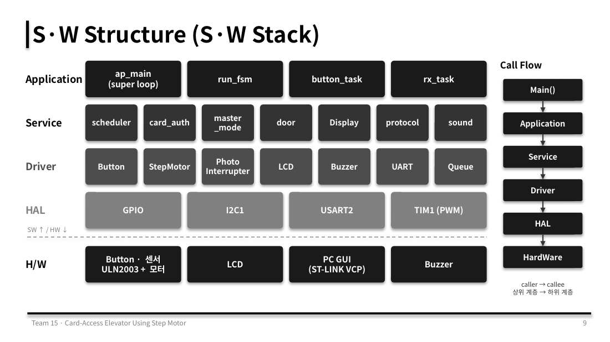

| 계층 | 모듈 |
|---|---|
| Application | `ap_main`(super loop), `run_fsm`, `button_task`, `rx_task` |
| Service | `scheduler`, `card_auth`, `master_mode`, `door`, `Display`, `protocol`, `sound` |
| Driver | Button, StepMotor, Photo Interrupter, LCD, Buzzer, UART, Queue |
| HAL | GPIO, I2C1, USART2, TIM1(PWM) |

```
Core/Src
├── main.c
├── ap/
│   ├── ap_main.c                # super loop, run_fsm(2-process FSM), motor_task
│   └── service/
│       ├── card_auth/           # 카드 종류 × 리더 → 호출 / 마스터 모드
│       ├── scheduler/           # 8bit 요청 레지스터, SCAN (should_stop / serve / next_dir)
│       ├── master_mode/         # 직원 마스터 모드 (5초, 층 버튼 1회)
│       ├── door/                # 문 열림 5초 카운트
│       ├── protocol/            # 8바이트 UART 프레임 송수신, 수신 큐(8칸)
│       ├── Display/             # LCD 화면 (floor, Closing in n sec)
│       ├── sound/               # 논블로킹 버튼음 (G6 → C7)
│       └── btn_event/           # 버튼 이벤트 큐(16칸)
├── common/queue/                # 링 버퍼 큐
└── driver/
    ├── stepmotor/  photo_interrupter/  button/
    └── lcd/  buzzer/  uart/  fnd/

GUI/
├── main.py                      # 실행 파일 (pyserial 자동 설치)
├── frontend/app.py              # tkinter 화면: 가상 엘리베이터, 조작반, 상태, 로그
└── backend/
    ├── controller.py            # 화면과 통신 사이 창구
    ├── link.py                  # SerialLink(보드) / MockLink(보드 없이)
    ├── codec.py                 # 8바이트 프레임 인코딩 · 디코딩
    ├── model.py                 # 펌웨어와 같은 운행 규칙(검증 모델), STM32 응답과 비교
    ├── mock_fw.py               # 보드 없이 시험하는 가짜 펌웨어
    └── scenario.py              # 랜덤 시나리오 생성
```

### Main Loop & Timing

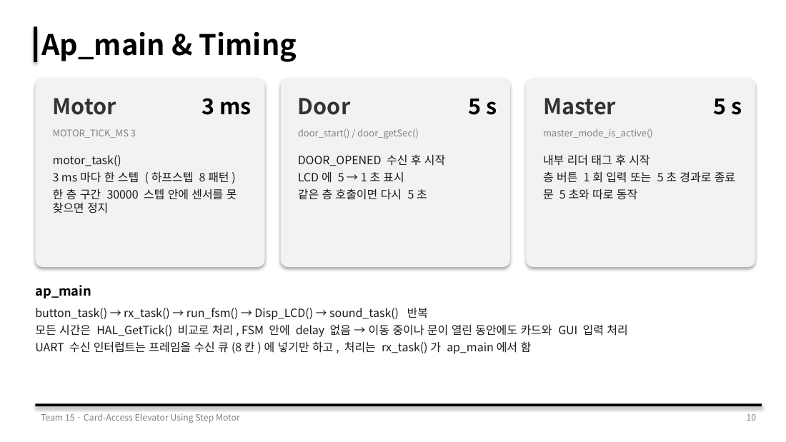

`button_task() → rx_task() → run_fsm() → Disp_LCD() → sound_task()`를 반복합니다.

| 항목 | 주기 | 동작 |
|---|---|---|
| Motor | 3 ms | `motor_task()`가 3ms마다 한 스텝(하프스텝 8패턴), 한 층 30,000 스텝 안에 센서를 못 찾으면 정지 |
| Door | 5 s | `DOOR_OPENED` 수신 후 시작, LCD에 5 → 1초 표시, 같은 층 호출이면 다시 5초 |
| Master | 5 s | 내부 리더 태그 후 시작, 층 버튼 1회 입력 또는 5초 경과로 종료 (문 타이머와 별도) |

## 상태 머신

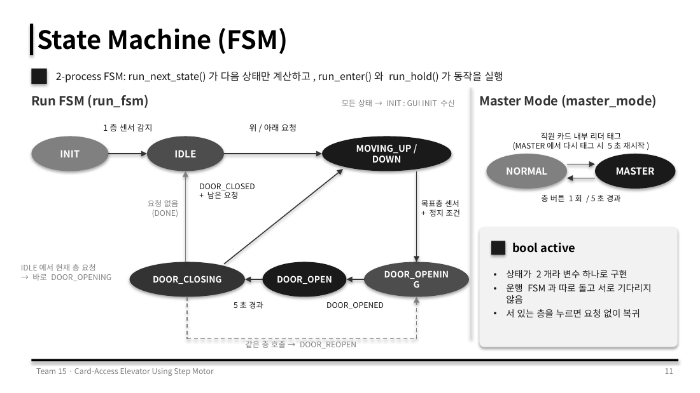

- **2-process FSM**: `run_next_state()`가 다음 상태만 계산하고, `run_enter()`와 `run_hold()`가 동작을 실행합니다.
- **Run FSM**: `INIT → IDLE → MOVING_UP/DOWN → DOOR_OPENING → DOOR_OPEN → DOOR_CLOSING → (남은 요청) MOVING / (요청 없음) IDLE`
  - IDLE에서 현재 층 요청이면 바로 `DOOR_OPENING`, 닫히는 중 같은 층 호출이면 `DOOR_REOPEN`
  - 모든 상태에서 GUI `INIT`을 받으면 `INIT`으로 복귀
- **Master Mode**: `NORMAL ↔ MASTER` 두 상태라 `bool active` 변수 하나로 구현, 운행 FSM과 따로 돌고 서로 기다리지 않음

## 구현 상세

### ① Card Tag: Request Register

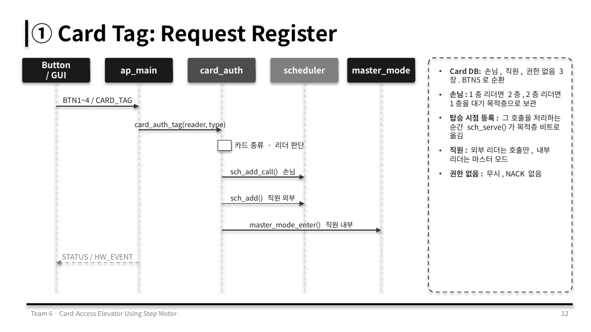

- 카드 DB: 손님 · 직원 · 권한 없음 3장, BTN5로 순환
- 손님: 1층 리더면 2층, 2층 리더면 1층을 대기 목적층으로 보관 → 그 호출을 처리하는 순간 `sch_serve()`가 목적층 비트로 옮김
- 직원: 외부 리더는 호출(`sch_add()`), 내부 리더는 `master_mode_enter()`
- 권한 없음: 무시, NACK 없음

### ② Scheduler: Direction-First (SCAN)

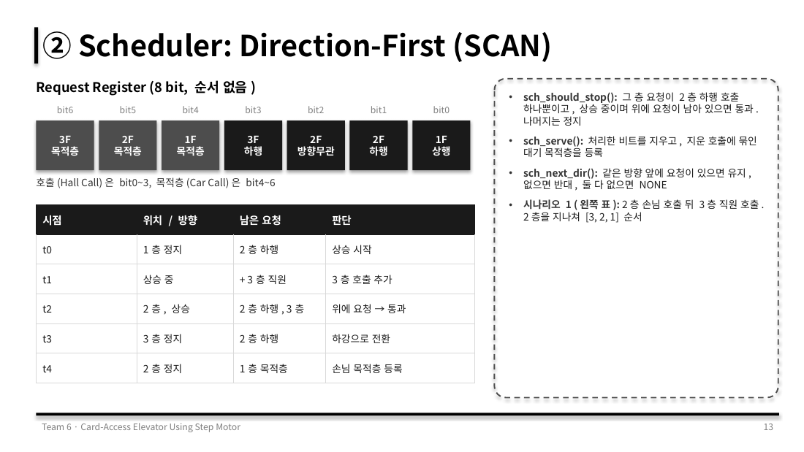

| 함수 | 역할 |
|---|---|
| `sch_should_stop()` | 그 층 요청이 "2층 하행 호출" 하나뿐이고, 상승 중이며 위에 요청이 남아 있으면 통과. 나머지는 정지 |
| `sch_serve()` | 처리한 비트를 지우고, 지운 호출에 묶인 대기 목적층을 등록 |
| `sch_next_dir()` | 같은 방향 앞에 요청이 있으면 유지, 없으면 반대, 둘 다 없으면 NONE |

### ③ Door: GUI Handshake

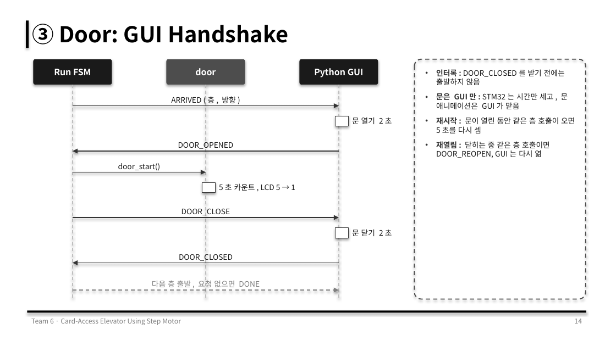

- **인터록**: `DOOR_CLOSED`를 받기 전에는 출발하지 않음
- **역할 분리**: STM32는 시간만 세고, 문 애니메이션은 GUI가 맡음
- **재시작 / 재열림**: 문이 열린 동안 같은 층 호출이면 5초를 다시 세고, 닫히는 중이면 `DOOR_REOPEN`

### ④ UART Protocol: 8-Byte Frame

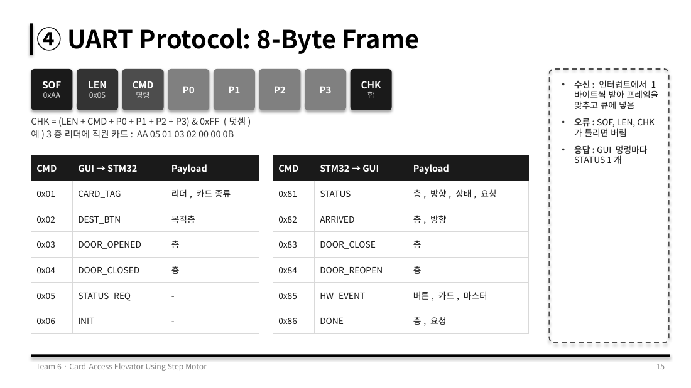

```
| SOF 0xAA | LEN 0x05 | CMD | P0 | P1 | P2 | P3 | CHK |
CHK = (LEN + CMD + P0 + P1 + P2 + P3) & 0xFF
예) 3층 리더에 직원 카드:  AA 05 01 03 02 00 00 0B
```

| CMD | GUI → STM32 | CMD | STM32 → GUI |
|---|---|---|---|
| `0x01` | CARD_TAG (리더, 카드 종류) | `0x81` | STATUS (층, 방향, 상태, 요청) |
| `0x02` | DEST_BTN (목적층) | `0x82` | ARRIVED (층, 방향) |
| `0x03` | DOOR_OPENED (층) | `0x83` | DOOR_CLOSE (층) |
| `0x04` | DOOR_CLOSED (층) | `0x84` | DOOR_REOPEN (층) |
| `0x05` | STATUS_REQ | `0x85` | HW_EVENT (버튼, 카드, 마스터) |
| `0x06` | INIT | `0x86` | DONE (층, 요청) |

수신은 인터럽트에서 1바이트씩 받아 프레임을 맞춘 뒤 큐에 넣고, SOF · LEN · CHK가 틀리면 버립니다.

## 트러블슈팅: 층 센서가 감지되지 않음

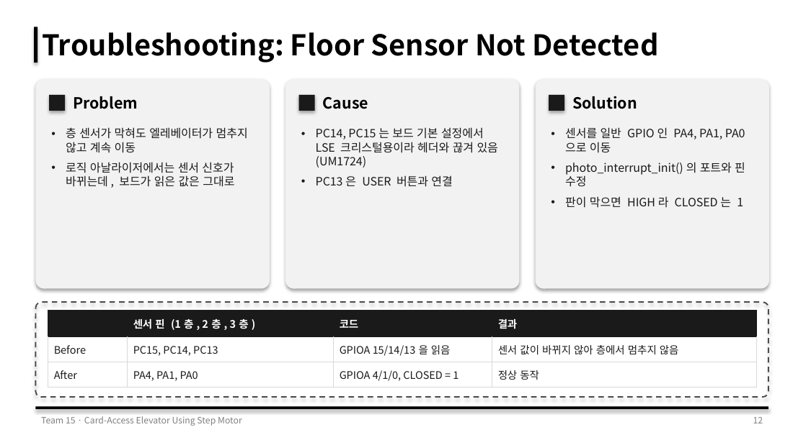

| | 센서 핀 (1층, 2층, 3층) | 코드 | 결과 |
|---|---|---|---|
| Before | PC15, PC14, PC13 | GPIOA 15/14/13을 읽음 | 센서 값이 바뀌지 않아 층에서 멈추지 않음 |
| **After** | **PA4, PA1, PA0** | GPIOA 4/1/0, CLOSED = 1 | 정상 동작 |

- **현상**: 층 센서가 막혀도 엘리베이터가 멈추지 않고 계속 이동. 로직 분석기에서는 센서 신호가 바뀌는데 보드가 읽은 값은 그대로
- **원인**: Nucleo 보드 기본 설정에서 PC14, PC15는 LSE 크리스털용이라 헤더와 끊겨 있고(UM1724), PC13은 USER 버튼과 연결되어 있음. 코드도 GPIOC가 아닌 GPIOA를 읽고 있었음
- **해결**: 센서를 일반 GPIO인 PA4, PA1, PA0으로 옮기고 `photo_interrupt_init()`의 포트와 핀 수정. 판이 막으면 HIGH라 `CLOSED = 1`

## 하드웨어

### BOM

| 부품 | 모델 / 사양 | 수량 | 용도 / 인터페이스 |
|---|---|---|---|
| MCU 보드 | STM32 Nucleo-F411RE (Cortex-M4, 100 MHz) | 1 | 메인 제어, ST-LINK 디버깅과 가상 COM |
| Step Motor | 28BYJ-48 (5V) | 1 | 엘리베이터 승강 · 하강 |
| 모터 드라이버 | ULN2003 드라이버 보드 | 1 | GPIO 4선 → 모터 코일 구동 |
| 포토인터럽터 | 슬롯형 (LED 330Ω, 풀업 4.7kΩ) | 3 | 층 감지, 판이 막으면 HIGH |
| LCD | TC1602A-01T 16x2 (I2C) | 1 | I2C1 (0x27), 현재 층과 문 카운트 |
| Buzzer | Passive Buzzer | 1 | TIM1 CH4 PWM, 버튼음 |
| Tact Switch | Push Button | 5 | 외부 리더 3, 내부 리더 1, 카드 선택 1 |
| PC | Python GUI | 1 | USART2 115200, 가상 엘리베이터와 문 |

### Pin Map

| 기능 | 신호 | 핀 | 설정 |
|---|---|---|---|
| I2C1 (LCD) | SCL / SDA | PB8 / PB9 | I2C |
| USART2 (GUI) | TX / RX | PA2 / PA3 | 115200 8N1 |
| 외부 리더 1~3층 | btn[0~2] | PC0, PC1, PC2 | GPIO Input |
| 내부 리더 | btn[3] | PC3 | GPIO Input |
| 카드 선택 | btn[4] | PB0 | GPIO Input |
| 층 센서 1~3층 | sensor[0~2] | PA4, PA1, PA0 | GPIO Input |
| Motor IN1~4 | motor_pin | PC10, PC11, PC12, PD2 | GPIO Output |
| Buzzer | TIM1 CH4 | PA11 | TIM1 PWM |

## 결론 및 고찰

**결론**
- 카드 권한, 마스터 모드, SCAN 스케줄러를 서비스 모듈로 나눠 구현하고 보드에서 모듈별 시험 통과
- 2-process FSM과 논블로킹 모터 구동으로 이동 중에도 카드와 GUI 입력 처리
- 8바이트 UART 프레임과 문 핸드셰이크로 GUI와 동작을 맞춤

**고찰**
- 모터가 센서를 못 찾았을 때 GUI에 알리는 프레임이 없음 → 오류 프레임 추가 필요
- 보드 기본 설정에서 쓸 수 없는 핀이 있으므로, 핀 배정 전에 보드 매뉴얼 확인 필요
- 초기 계획서에서 기능과 상태(FSM), 핀 배치를 먼저 정하고 그대로 개발에 적용하니 역할 분담과 통합이 수월했음

## 실행 방법

**펌웨어**
1. STM32CubeIDE에서 `File → Import → Existing Projects into Workspace`로 이 폴더를 엽니다.
2. `test_elevator.ioc`로 핀 설정을 확인할 수 있습니다.
3. Build 후 Nucleo-F411RE에 Run 합니다.

**GUI** (Python 3, tkinter)
```bash
cd GUI
python main.py        # pyserial이 없으면 처음 실행할 때 자동 설치
```
포트에서 보드의 ST-LINK 가상 COM 포트를 선택하고 Connect 합니다. 보드가 없으면 `MOCK`을 선택하세요.

## 개발 환경

STM32CubeIDE, STM32 HAL (STM32F4xx), C, Python (tkinter, pyserial)
