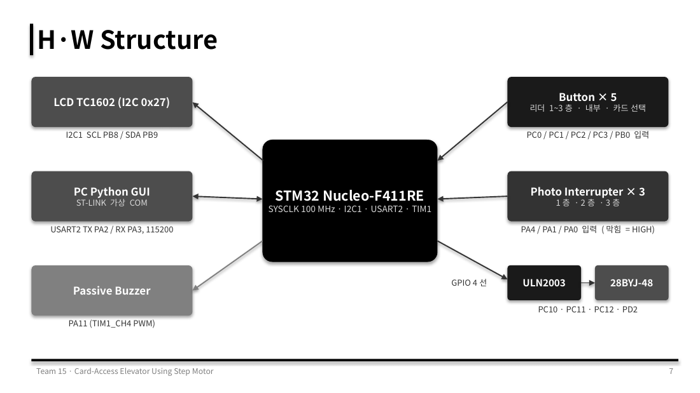
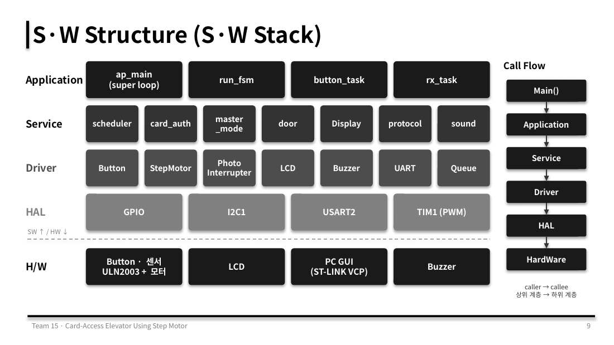

# STM32 카드 권한 엘리베이터 개발계획서 v1.6 (최종)

*Development Plan & Specification*

| 항목 | 내용 |
|---|---|
| 작성일 | 2026-11-07 |
| 단계 | STM32 펌웨어, Python GUI 구현 완료. 실물 모터 통합 시험 중 |
| 플랫폼 | STM32 Nucleo-F411RE + Python GUI (USART 연결) |
| 기간 / 인원 | 4일 / 2명 |
| 기준 소스 | `D:\STM_Workspace\test_elevator` (펌웨어 `Core/Src`, GUI `GUI/`) |

---

## 1. 개요

### 1.1 목적
층 정보가 담긴 카드로 갈 수 있는 층을 제한하는 호텔형 엘리베이터를 STM32로 구현합니다. 목적은 소프트웨어 제어가 아닌 **하드웨어 제어**이며, Python GUI 시뮬레이터는 STM32가 명령을 받아 하드웨어적으로 정상 동작하는지 눈으로 확인하고, 같은 운행 규칙으로 응답을 검증하는 가상 환경입니다.

| 구현 대상 | 구현 방식 |
|---|---|
| STM32 펌웨어 (스케줄러, FSM, 모터, 센서, 버튼, 부저, LCD) | 직접 구현 |
| Python GUI 시뮬레이터 | AI 도움을 받아 구현 |

### 1.2 범위
| 포함 | 제외 |
|---|---|
| 카드 권한 판단, 방향 우선 운행, 직원(마스터) 모드 | 비상정지 |
| 스텝모터 구동, 포토인터럽터 층 감지, 전원 투입 시 INIT | 과부하 |
| LCD 현재 층과 문 5초 카운트 표시 | 권한 거부 응답 (NACK) |
| 버튼 입력 시 부저 버튼음 (하드웨어 버튼, GUI 버튼 모두) | 하드웨어 문 (문은 GUI에서만 구현) |
| 문 열림 중 출발 금지 인터록 | GUI 미연결 상황 (GUI는 항상 연결된 것으로 가정) |
| USART 통신, Python GUI 시뮬레이터 | 센서 실패 GUI 알림 (R4, 구현하지 않기로 결정) |
| 하드웨어 버튼 입력도 GUI 가상 엘리베이터와 검증 모델에 반영 (`HW_EVENT`) | |
| GUI 랜덤 시나리오와 응답 검증 (하드웨어로 만들기 어려운 상황 시험) | |

### 1.3 용어
| 용어 | 뜻 |
|---|---|
| 외부 리더 | 각 층 승강장에 1개씩 있는 카드 리더. 자기가 몇 층 리더인지 알고 있음 |
| 내부 리더 | 엘리베이터 안의 카드 리더. 직원만 사용 |
| 호출 (Hall Call) | 외부 리더 태그로 엘리베이터를 그 층으로 부르는 요청 |
| 목적층 요청 (Car Call) | 엘리베이터가 가야 할 층 요청 |
| 대기 목적층 (Pending) | 손님이 카드를 찍었을 때 정해진 목적층. 탑승 시점에 목적층 요청으로 등록됨 |
| 마스터 모드 | 직원이 내부 리더에 태그했을 때 5초 동안 층 버튼을 1회 누를 수 있는 상태 |
| 방향 우선 집합 운전 | 현재 방향 앞쪽 요청을 먼저 다 처리하고 나서 방향을 바꾸는 운행 규칙 (SCAN 알고리즘) |
| 방향 무관 호출 | 올라가는 중이든 내려가는 중이든 지나가는 길에 멈추는 호출. 2층 직원 호출에 사용 |
| 카드 선택 버튼 | 실제 카드가 없으므로, 지금 "들고 있는" 카드를 다음 카드로 바꾸는 하드웨어 버튼 (BTN5) |
| 검증 모델 | GUI 안에서 펌웨어와 같은 운행 규칙을 Python으로 돌려 STM32 응답과 비교하는 모듈 (`GUI/backend/model.py`) |

---

## 2. 시스템 구성

- 층 수: 1층(로비), 2층(투숙객 층), 3층(직원 전용 층)
- 카드 정보(DB)는 STM32가 가지고 있고, 권한 판단도 STM32가 합니다. GUI는 카드 종류(손님, 직원, 권한 없음)만 보냅니다.
- 문은 하드웨어에 없고 GUI에서만 구현합니다.
- 손님 이용 내역(태그, 탑승, 하차)은 GUI 로그 창에만 표시합니다.

### 2.1 하드웨어 구조



### 2.2 소프트웨어 구조 (계층)



| 계층 | 모듈 (`Core/Src`) |
|---|---|
| Application | `ap/ap_main.c` (슈퍼 루프, 운행 FSM, 버튼 해석, GUI 프레임 처리) |
| Service | `card_auth`, `master_mode`, `scheduler`, `door`, `Display`, `protocol`, `sound` |
| Driver | `button`, `photo_interrupter`, `stepmotor`, `lcd`, `buzzer`, `uart`, `common/queue` (링버퍼) |
| HAL | STM32 HAL (CubeMX 생성 `main.c`, `stm32f4xx_hal_msp.c`) |

- 호출 방향은 항상 상위 계층에서 하위 계층으로 갑니다 (Application, Service, Driver, HAL 순).
- 예외로 Service 안에서 `Display`는 `door`의 남은 초를 직접 읽고, `card_auth`는 `scheduler`와 `master_mode`를, `master_mode`는 `scheduler`를 직접 호출합니다. 반대 방향 호출은 하지 않습니다 (5.7).
- 요청 레지스터 비트(`REQ_xxx`)와 방향(`sch_dir_t`)은 `scheduler.h`에, UART 명령 코드와 프레임 구조는 `protocol.h`에 있습니다.
- UART 수신 인터럽트는 프레임을 큐에 넣기만 하고, 처리는 ap_main의 슈퍼 루프에서 합니다.
- 버튼과 포토인터럽터는 슈퍼 루프에서 폴링으로 읽습니다.

---

## 3. 기능 요구사항

### 3.1 카드 정책
- 카드 1장에는 층 1개만 등록됩니다.
- 권한이 없는 카드를 찍으면 아무 동작도 하지 않습니다 (응답도 보내지 않음). 단, 버튼음은 납니다.
- 손님은 1층으로 내려갈 때도 카드가 필요합니다.

**카드 DB (`card_auth.c`, BTN5로 순환)**

| 번호 | 카드 | 종류 코드 | 등록 층 |
|---|---|---|---|
| 0 | 손님 A | 0x01 GUEST | 2층 |
| 1 | 손님 B | 0x01 GUEST | 2층 |
| 2 | 직원 | 0x02 STAFF | 전 층 (마스터) |
| 3 | 권한 없음 | 0x00 NO_AUTH | 없음 |

- BTN5를 누를 때마다 0, 1, 2, 3, 0 순서로 다음 카드를 "들게" 됩니다. 선택된 카드 번호는 `HW_EVENT`로 GUI에 보내고, GUI 상태 창의 "보드 카드"에 표시합니다.
- 이후 리더 버튼(BTN1~4)을 누르면 지금 들고 있는 카드 종류로 동작합니다.
- GUI는 카드 DB와 관계없이 카드 종류만 보내므로, 손님이나 직원을 몇 명이든 만들어 시험할 수 있습니다 (6.5 랜덤 시나리오).

### 3.2 카드 종류와 리더별 동작
| 카드 | 외부 리더 | 내부 리더 |
|---|---|---|
| 손님 (2층) | 그 층으로 호출. 목적층은 대기 목적층으로 보관했다가 탑승 시점에 자동 등록 (3.3) | 기능 없음 (무시) |
| 직원 (마스터) | 그 층으로 호출만 함 | 마스터 모드 진입 (3.5) |
| 권한 없음 | 무시 | 무시 |

- 문은 직원, 손님과 관계없이 **완전히 열린 뒤 5초가 지나면 닫힙니다** (3.8).

### 3.3 손님 목적층 자동 결정 규칙
| 태그한 외부 리더 | 등록되는 호출 | 결정되는 목적층 |
|---|---|---|
| 1층 | 1층 상행 (bit0) | 카드에 등록된 층 (2층) |
| 카드 등록 층 (2층) | 2층 하행 (bit1) | 1층 |
| 그 외 층 (3층) | 없음 | 권한 없음, 무시 |

**등록 시점**
- 카드를 찍는 순간에는 **호출만 등록**하고, 목적층은 그 호출에 묶인 대기 목적층으로 보관합니다 (`sch_add_call`).
- 엘리베이터가 그 층에 서서 **그 호출을 처리하는 순간** 대기 목적층을 목적층 요청으로 등록합니다 (`sch_serve`).
- 같은 층에서 손님 여러 명이 찍었다면, 엘리베이터가 그 층에서 호출을 처리할 때 모두 한 번에 등록됩니다.

**이유:** 엘리베이터가 3층에 있을 때 1층 손님이 카드를 찍는 순간 2층 목적층까지 등록하면, 내려오는 길에 아무도 타지 않은 2층에서 멈추게 됩니다.

### 3.4 외부 호출의 방향
| 층 | 손님 호출 | 직원 호출 |
|---|---|---|
| 1층 | 상행 | 상행 |
| 2층 | 하행 (올라가는 중에는 지나침) | **방향 무관 (올라가든 내려가든 지나가는 길에 정지)** |
| 3층 | 해당 없음 (권한 없음) | 하행 |

- 손님은 2층에서 1층으로만 가므로 하행으로 고정합니다.
- 직원은 탑승 후 목적층을 고르기 때문에 호출 시점에는 방향을 알 수 없습니다. 그래서 2층 직원 호출은 지나가는 길에 바로 태웁니다.

### 3.5 직원 (마스터) 모드
1. 직원이 외부 리더에 태그하면 엘리베이터를 그 층으로 호출합니다.
2. 탑승 후 내부 리더에 태그하면 마스터 모드에 들어가고 5초 타이머가 시작됩니다 (`MASTER_TIME_MS` 5000).
3. 마스터 모드에서는 **BTN1~BTN3이 외부 리더가 아니라 층 버튼(목적층 1~3층)**이 됩니다. GUI의 `DEST_BTN`도 같은 동작입니다. BTN4는 무시합니다.
4. 5초 안에 층 버튼을 누르면
   - 목적층 요청이 등록되고 즉시 일반 모드로 돌아갑니다.
   - 현재 진행 방향과 반대인 층을 눌러도 요청은 저장됩니다. 진행 방향의 요청을 다 처리하고 방향을 바꾼 뒤에 처리합니다.
   - 첫 번째 버튼만 받습니다.
   - 지금 서 있는 층을 누르면 요청을 등록하지 않고 일반 모드로 돌아갑니다.
5. 5초 동안 입력이 없으면 일반 모드로 돌아갑니다. **마스터 모드 5초와 문 5초는 서로 관계없이 따로 동작**합니다.
6. 직원 요청은 일반 요청과 같은 운행 규칙으로 처리합니다. 끼어들기는 없습니다.
7. 마스터 권한은 요청 1건 단위입니다. 엘리베이터 전체 모드를 바꾸지 않습니다.
8. 마스터 모드에서 직원 카드로 내부 리더에 다시 태그하면 5초가 다시 시작됩니다.

### 3.6 운행 규칙 (방향 우선 집합 운전)
- 현재 방향 앞쪽에 요청이 남아 있으면 계속 갑니다. 없으면 방향을 바꿉니다.
- 지나가는 층에 아래 요청 중 하나라도 있으면 멈춥니다 (`sch_should_stop`).
  - 목적층 요청
  - 방향 무관 호출 (2층 직원 호출)
  - 1층 상행, 3층 하행 호출
  - 2층 하행 호출: 하강 중이거나, 상승 중이라도 위쪽에 요청이 더 없을 때 (그 층에서 방향 전환)
- 상승 중 2층에 섰는데 위쪽에 요청이 남아 있으면 2층 하행 호출은 지우지 않고 남겨 둡니다. 그 호출에 묶인 손님 목적층도 등록하지 않습니다.
- 남은 요청이 하나도 없으면 진행 방향을 해제합니다. 다음에 들어오는 요청이 방향을 정합니다.
- 요청을 누른 순서는 운행 순서에 영향을 주지 않습니다.
- 현재 층에 서 있을 때 그 층 호출이 들어오면 이동 없이 문을 엽니다.

### 3.7 운행 시나리오

**시나리오 1: 2층 손님 호출 후, 올라가는 중에 3층 직원 호출**

| 시점 | 위치 / 방향 | 남은 요청 | 판단 |
|---|---|---|---|
| t0 | 1층 정지 | 2층 하행 호출 (손님) | 위쪽에 요청 있음, 상승 시작 |
| t1 | 1층과 2층 사이, 상승 | 2층 하행, 3층 호출 추가 | |
| t2 | 2층 도착, 상승 | 2층 하행, 3층 | 2층은 손님 하행 호출이고 위에 3층이 남아 있으므로 통과 |
| t3 | 3층 정지 | 2층 하행 | 3층 요청 지움, 위쪽 요청 없음, 하강으로 전환 |
| t4 | 2층 정지, 하강 | 1층 목적층 | 2층 호출 처리, 손님 대기 목적층 1층 등록 |
| t5 | 1층 정지 | 없음 | 대기 (`DONE`) |

**시나리오 2: 엘리베이터가 3층에 있을 때 1층에서 손님 2명이 찍음**

| 시점 | 위치 / 방향 | 남은 요청 | 판단 |
|---|---|---|---|
| t0 | 3층 정지 | 1층 상행 호출 (대기 목적층 2층) | 2층 목적층은 아직 등록하지 않음 |
| t1 | 2층 통과, 하강 | 1층 상행 호출 | 2층에 요청이 없으므로 통과 |
| t2 | 1층 정지 | 2층 목적층 | 1층 호출 처리, 두 손님의 대기 목적층 등록, 상승으로 전환 |
| t3 | 2층 정지 | 없음 | 하차, 대기 |

**시나리오 3: 3층 직원 호출을 받으러 올라가는 중에 2층 직원 호출**

| 시점 | 위치 / 방향 | 남은 요청 | 판단 |
|---|---|---|---|
| t0 | 1층에서 상승 | 3층 호출 | |
| t1 | 1층과 2층 사이, 상승 | 3층 호출, 2층 직원 호출 추가 | |
| t2 | 2층 정지, 상승 | 3층 호출 | 방향 무관 호출이므로 정지, 2층 직원 탑승 |
| t3 | 2층 정지 | 3층 호출 + 2층 직원 목적층 | 2층 직원이 마스터 모드로 3층 또는 1층 입력 |
| t4 | 3층 정지 | (2층 직원이 1층을 눌렀다면) 1층 목적층 | 3층 직원 탑승. 2층 직원이 3층을 눌렀다면 여기서 하차 |
| t5 | 3층 정지 | 1층 + 3층 직원 목적층 (1층 또는 2층) | 하강으로 전환 |
| t6 | 하강 | | 3층 직원 목적층과 1층을 지나가는 순서대로 처리 |

**시나리오 4: 3층에서 직원을 태우고 내려가는 중에 2층 직원 호출**

| 시점 | 위치 / 방향 | 남은 요청 | 판단 |
|---|---|---|---|
| t0 | 3층에서 하강 | 3층 직원 목적층 (1층 또는 2층) | |
| t1 | 3층과 2층 사이, 하강 | 2층 직원 호출 추가 | |
| t2 | 2층 정지, 하강 | | 2층 직원 탑승. 3층 직원이 2층을 눌렀다면 여기서 하차 |
| t3-a | 3층 직원이 1층을 누른 경우 | 1층 목적층 + 2층 직원 목적층 | 1층으로 내려감. 2층 직원이 3층을 눌렀다면 1층 이후 방향을 바꿔 3층으로 감 |
| t3-b | 3층 직원이 2층에서 내렸고 1층 요청이 없는 경우 | 2층 직원 목적층 | 남은 요청이 없으므로 진행 방향 해제. 2층 직원이 누르는 층으로 방향 결정 |

### 3.8 문 (GUI에서만 구현)
- 문 열림 유지 시간: 5초 (STM32 `door.c` `DOOR_OPEN_MS` 5000, LCD에 표시)
- 문 열기/닫기 동작 시간: 각 2초 (GUI 애니메이션, `DOOR_MOVE_S` 2.0)
- 문이 완전히 닫혔다는 신호를 받기 전에는 출발하지 않습니다 (인터록).
- 문이 열려 있는 동안 그 층 호출이 다시 들어오면 **5초 카운트를 처음부터 다시 시작**합니다.

문 동작 순서 (핸드셰이크):

| 순서 | 주체 | 동작 | 프레임 |
|---|---|---|---|
| 1 | STM32 | 층 도착, 정지 | STM32 → GUI `ARRIVED` |
| 2 | GUI | 2초 동안 문 열기 | |
| 3 | GUI | 문 열림 완료 알림 | GUI → STM32 `DOOR_OPENED` |
| 4 | STM32 | 5초 카운트 (LCD 1번째 줄에 남은 초 표시, 끝나면 지움) | |
| 5 | STM32 | 문 닫기 지시 | STM32 → GUI `DOOR_CLOSE` |
| 6 | GUI | 2초 동안 문 닫기 | |
| 7 | GUI | 문 닫힘 완료 알림 | GUI → STM32 `DOOR_CLOSED` |
| 8 | STM32 | 다음 목표층으로 출발. 남은 요청이 없으면 IDLE로 복귀하고 완료 신호 전송 | 요청 없을 때 STM32 → GUI `DONE` |

- 문이 닫히는 중(6단계)에 같은 층 호출이 들어오면 STM32가 `DOOR_REOPEN`을 보내고, GUI는 닫기를 멈추고 다시 엽니다. 이후 2단계부터 반복합니다.
- GUI는 프레임을 놓쳐도 `STATUS`의 FSM 상태(DOOR_OPENING, DOOR_CLOSING)를 보고 문 목표를 맞추고, 펌웨어가 아직 같은 상태면 1초 뒤 `DOOR_OPENED`/`DOOR_CLOSED`를 다시 보냅니다.

---

## 4. 하드웨어 구성

| 요소 | 부품 | 비고 |
|---|---|---|
| 엘리베이터 이동 | 스텝모터 28BYJ-48 + 드라이버 | 하프스텝, 실에 매단 칸을 감아 올림 |
| 층 감지 | 포토인터럽터 3개 | 층마다 센서 1개, 판이 슬롯을 막으면 그 층으로 판정 (4.2) |
| 입력 | 하드웨어 버튼 5개, GUI 버튼 | 4.1 |
| 버튼음 | 패시브 부저 | TIM1_CH4 PWM. 하드웨어 버튼, GUI 버튼 입력 모두 버튼음 출력 (5.8) |
| 문 | 없음 | GUI에서만 구현 |
| 상태 표시 | LCD TC1602A-01T (I2C, 주소 0x27) | 0번째 줄 현재 층, 1번째 줄 문 열림 5초 카운트 |

### 4.1 하드웨어 버튼 (5개)
| 버튼 | 일반 모드 | 마스터 모드 |
|---|---|---|
| BTN1 | 1층 외부 리더 (들고 있는 카드로 태그) | 목적층 1층 |
| BTN2 | 2층 외부 리더 | 목적층 2층 |
| BTN3 | 3층 외부 리더 | 목적층 3층 |
| BTN4 | 내부 리더 | 무시 |
| BTN5 | 카드 선택 (다음 카드) | 카드 선택 (다음 카드) |

- 버튼은 누르는 순간(`ACT_PUSH`)에 한 번만 처리합니다. 디바운스는 엣지마다 5ms (`button.c`).
- 모든 버튼 입력은 버튼음을 내고 `HW_EVENT`(버튼 번호, 현재 카드 번호, 누른 순간의 마스터 모드 여부)를 GUI로 보냅니다.
- GUI는 `HW_EVENT`를 검증 모델에 그대로 넣어 하드웨어 버튼으로 생긴 요청도 비교합니다.

### 4.2 포토인터럽터와 층 판정
층마다 센서를 1개씩 두고, **판이 슬롯을 막은 센서의 층**을 현재 층으로 판정합니다. 판이 슬롯을 막으면 센서 입력은 HIGH입니다 (`photo_interrupter.h` `CLOSED = 1`).

| 층 | 센서1 (PA4) | 센서2 (PA1) | 센서3 (PA0) |
|---|---|---|---|
| 1층 | 막힘 | 열림 | 열림 |
| 2층 | 열림 | 막힘 | 열림 |
| 3층 | 열림 | 열림 | 막힘 |
| 모두 열림 | 층과 층 사이 (층 아님) | | |

**이동 중 층 도착 판정**
- 센서는 메인 루프에서 폴링으로 레벨을 직접 읽습니다 (EXTI 없음).
- 이동 방향의 **다음 층 센서만** 봅니다 (상승 중이면 현재 층 + 1, 하강 중이면 현재 층 - 1). 출발할 때 떠나는 층 센서는 보지 않으므로 잡음이 걸러집니다.
- 다음 층 센서가 감지되면
  - 그 층이 정지 조건(3.6)이면 그 자리에서 정지합니다 (`run_next_state`).
  - 정지 조건이 아니면 현재 층만 갱신하고 계속 갑니다 (`run_hold`, 서지 않고 지나가는 층).
- **v1.6 수정:** `run_hold`의 "지나가는 층" 처리는 정지 조건이 **아닐 때만** 합니다. 이전에는 한 루프에서 센서를 두 번 읽는 사이에 값이 바뀌면 멈춰야 할 층을 지나가는 층으로 처리해서, 1층을 지나쳐 모터가 계속 도는 문제가 있었습니다.
- **v1.6 안전장치:** 이동 중에 다음 층이 1~3층 밖이면 (1층에서 하강, 3층에서 상승) 바로 정지하고 IDLE로 갑니다. 요청은 지우지 않습니다.
- 별도의 센서 디바운스는 두지 않았습니다. 정지 판정은 정지 층 센서가 처음 감지되는 순간 한 번이고, 정지 후에는 센서를 보지 않기 때문입니다.
- 모든 층은 센서 가장자리에서 정지해도 문제없습니다 (정지 위치 보정 안 함).

**전원 투입 시 INIT**
- 엘리베이터는 항상 1층에서 시작합니다.
- 1층 센서가 이미 감지되면 **모터를 돌리지 않고** 바로 IDLE로 갑니다.
- 1층 센서가 감지되지 않으면 1층 센서가 감지될 때까지 하강합니다. 2층과 3층 센서는 보지 않습니다.
- INIT은 엣지가 아니라 **현재 레벨**로 판정합니다.
- GUI의 `INIT` 명령을 받으면 어느 상태에서든 INIT으로 돌아가 요청, 마스터 모드, 문 타이머를 모두 지우고 다시 1층을 찾습니다.

### 4.3 사용 부품
| 요소 | 부품 |
|---|---|
| MCU | Nucleo-F411RE (100MHz, HSE 8MHz) |
| 스텝모터 | 28BYJ-48 (하프스텝 4096스텝/회전) |
| LCD | TC1602A-01T (I2C 백팩, 0x27) |
| 부저 | 패시브 부저 |
| 버튼 | 택트 스위치 |
| 층 센서 | 포토인터럽터 3개 |

### 4.4 핀 맵
| 기능 | 핀 | 비고 |
|---|---|---|
| BTN1~BTN4 | PC0, PC1, PC2, PC3 | 1층, 2층, 3층 외부 리더, 내부 리더. GPIO 입력, 폴링, 누르면 LOW |
| BTN5 | PB0 | 카드 선택. GPIO 입력, 폴링 |
| 부저 | PA11 | TIM1_CH4 PWM (AF1) |
| LCD I2C | PB9 SDA, PB8 SCL | I2C1 100kHz |
| 포토인터럽터 1, 2, 3 | PA4, PA1, PA0 | 각각 1층, 2층, 3층. 판이 막으면 HIGH. GPIO 입력, 풀업/풀다운 없음 |
| 스텝모터 IN1~IN4 | PC10, PC11, PC12, PD2 | GPIO 출력. CW가 상승 |
| GUI 통신 | PA2 TX, PA3 RX (USART2, 115200 8N1) | ST-Link 가상 COM 포트 |

**사용하지 않는 핀 (.ioc에는 설정만 남아 있음)**
- PA5~PA10, PB3~PB6, PB10, PC7: 이전 FND용 출력 (FND 사용 안 함, Q24)
- PC4 출력, PB7 입력, PC13~PC15 입력: 사용처 없음
- TIM3, TIM4: 인터럽트만 켜져 있고 사용처 없음
- 참고: Nucleo에서 PC14, PC15는 32kHz 크리스털에 연결돼 있어 헤더 핀으로 신호가 들어오지 않고, PC13은 USER 버튼과 공유합니다. 그래서 포토인터럽터를 PA4, PA1, PA0으로 옮겼습니다. PA13, PA14는 SWD(디버거) 핀이므로 쓰지 않습니다.

---

## 5. 소프트웨어 설계

### 5.1 처리 흐름

```
[USART2 수신 인터럽트]   uart.c rx_parse_byte : SOF/LEN/체크섬 검사
        |
        v
   [수신 큐 (링버퍼 8개)]  protocol.c : 프레임을 들어온 순서대로 보관만 함
        |
        v
   [슈퍼 루프 ap_main]     button_task -> rx_task -> run_fsm -> Disp_LCD -> sound_task
        |
        v
   [버튼 의미 해석]        마스터 모드 여부에 따라 BTN1~3의 의미 결정, 버튼음, HW_EVENT
        |
        v
   [카드 권한 판단]        card_auth : 카드 종류 x 리더 -> 호출 등록, 손님 대기 목적층, 마스터 모드
        |
        v
   [요청 레지스터]         scheduler : 층별 요청 비트 (순서 없음)
        |
        v
   [스케줄러]              sch_should_stop / sch_serve / sch_next_dir
        |
        v
   [운행 FSM]              INIT, IDLE, MOVING_UP, MOVING_DOWN, DOOR_OPENING, DOOR_OPEN, DOOR_CLOSING
        |
        v
   [스텝모터 / LCD / 부저 / USART 송신]
```

### 5.2 요청 레지스터 구성 (`scheduler.h`)
| 비트 | 매크로 | 설정 조건 | 정지 조건 |
|---|---|---|---|
| bit0 | `REQ_1F_UP` | 1층 외부 리더 (손님, 직원) | 1층 도착 시 |
| bit1 | `REQ_2F_DOWN` | 2층 외부 리더 (손님) | 하강 중 2층 도착, 또는 위쪽 요청이 없을 때 |
| bit2 | `REQ_2F_ANY` | 2층 외부 리더 (직원) | 방향과 관계없이 2층 도착 시 |
| bit3 | `REQ_3F_DOWN` | 3층 외부 리더 (직원) | 3층 도착 시 |
| bit4~6 | `REQ_DEST(1~3)` | 손님 대기 목적층 등록, 직원 마스터 모드 입력 | 방향과 관계없이 해당 층 도착 시 |

- 대기 목적층은 **호출 비트별로** 따로 보관합니다 (`pending_1up`, `pending_2down`). 그 호출 비트가 지워지는 순간에만 목적층 비트로 옮깁니다.

### 5.3 운행 FSM과 마스터 모드

마스터 모드는 운행 FSM의 상태로 넣지 않습니다. 마스터 모드 5초와 문 5초는 서로 독립이고, 마스터 모드 중에도 운행 FSM은 계속 돌아야 하기 때문입니다.

```
ap_main() 슈퍼 루프 한 바퀴
 1. button_task : 버튼 폴링 -> 버튼 의미 해석 -> 요청 비트 세팅, 버튼음, HW_EVENT 송신
 2. rx_task     : 수신 큐 비우기 -> 명령 처리 (CARD_TAG, DEST_BTN, 문 신호, INIT), 프레임마다 STATUS 송신
 3. run_fsm     : next = run_next_state() -> 바뀌면 run_enter(next) -> run_hold()
 4. Disp_LCD    : 값이 바뀐 줄만 다시 씀
 5. sound_task  : 버튼음 진행
```

- 운행 FSM은 다음 상태 계산(`run_next_state`), 상태 진입 동작(`run_enter`), 상태 유지 동작(`run_hold`)으로 나눠 작성합니다 (RTL 2-process FSM 방식).
- 마스터 모드는 `bool active` 하나로 구현하고, `master_mode_is_active()`를 부를 때 5초 경과를 판단합니다.
- FSM 안에서 delay를 쓰지 않습니다. 모든 시간은 `HAL_GetTick()` 비교로 처리합니다.
- 진행 방향 `dir`은 상태와 별도 변수로 둡니다. 문이 열려 있는 동안에도 "어느 방향으로 가던 중이었는지"를 알아야 문이 닫힌 뒤 SCAN 판단을 할 수 있기 때문입니다.
- GUI 입력 플래그(`in_door_opened`, `in_door_closed`, `in_init`)는 루프마다 한 번 쓰고 지웁니다.

### 5.4 마스터 모드 상태 전이표
| 현재 | 조건 | 다음 | 동작 |
|---|---|---|---|
| NORMAL | 직원 카드로 내부 리더 태그 | MASTER | 5초 타이머 시작 |
| MASTER | 직원 카드로 내부 리더 다시 태그 | MASTER | 5초 타이머 재시작 |
| MASTER | 층 버튼 입력, 서 있는 층이 아님 | NORMAL | 목적층 비트 세팅 |
| MASTER | 층 버튼 입력, 서 있는 층 | NORMAL | 요청 없음 |
| MASTER | 5초 경과 | NORMAL | 없음 (문은 문 타이머대로 동작) |

### 5.5 운행 FSM 상태 전이표 (`ap_main.c`)
| 현재 | 조건 | 다음 | 진입 동작 |
|---|---|---|---|
| 모든 상태 | GUI `INIT` 수신 | INIT | 모터 정지, 요청/마스터/문 타이머 초기화 |
| INIT | 1층 센서 감지, 또는 `MAX_STEPS` 초과 | IDLE | 모터 정지, 현재 층 = 1층 |
| IDLE | 현재 층에 정지 조건 | DOOR_OPENING | 요청 처리, `ARRIVED` 송신 |
| IDLE | 위쪽에 요청 | MOVING_UP | dir = UP |
| IDLE | 아래쪽에 요청 | MOVING_DOWN | dir = DOWN |
| MOVING_UP/DOWN | `MAX_STEPS` 초과 (센서 못 찾음) | IDLE | 모터 정지, 요청 모두 지움 |
| MOVING_UP/DOWN | 다음 층이 1~3층 밖 (안전장치) | IDLE | 모터 정지 (요청 유지) |
| MOVING_UP/DOWN | 다음 층 센서 감지 그리고 정지 조건 (3.6) | DOOR_OPENING | 모터 정지, 현재 층 갱신, 요청 처리, `ARRIVED` 송신 |
| MOVING_UP/DOWN | 다음 층 센서 감지, 정지 조건 아님 | 그대로 | 현재 층 갱신, 스텝 카운트 초기화 |
| DOOR_OPENING | `DOOR_OPENED` 수신 | DOOR_OPEN | 문 5초 타이머 시작 |
| DOOR_OPEN | 5초 경과 | DOOR_CLOSING | 타이머 종료 (LCD 카운트 지움), `DOOR_CLOSE` 송신 |
| DOOR_CLOSING | 이 층에 정지 조건인 새 요청 | DOOR_OPENING | 요청 처리, `DOOR_REOPEN` 송신 |
| DOOR_CLOSING | `DOOR_CLOSED` 수신, 진행 방향 앞에 요청 | MOVING_(dir) | |
| DOOR_CLOSING | `DOOR_CLOSED` 수신, 반대쪽에만 요청 | MOVING_(반대) | dir 반전 |
| DOOR_CLOSING | `DOOR_CLOSED` 수신, 요청 없음 | IDLE | dir = NONE, `DONE` 송신 |

**상태 유지 중 동작 (`run_hold`)**
- INIT: 3ms마다 한 스텝 하강
- MOVING: 지나가는 층 갱신 (정지 조건이 아닐 때만), 3ms마다 한 스텝
- DOOR_OPENING, DOOR_OPEN: 이 층에 정지 조건인 새 요청이 들어오면 바로 처리합니다. DOOR_OPEN이면 5초 카운트를 다시 시작합니다.

### 5.6 스케줄러 함수 (`scheduler.c`)
| 함수 | 역할 |
|---|---|
| `sch_init()` | 요청 레지스터와 대기 목적층 초기화 |
| `sch_add(비트)` | 요청 비트 등록 |
| `sch_add_call(호출, 목적층)` | 손님 호출과 대기 목적층 등록 |
| `sch_get_req()` | 요청 레지스터 값 (STATUS, DONE 응답용) |
| `sch_req_ahead(층, 방향)` | 그 방향 앞쪽 층에 요청이 있는지 |
| `sch_should_stop(층, 방향)` | 3.6 정지 조건 판단 |
| `sch_serve(층, 방향)` | 처리한 요청 비트 지우기, 지운 호출에 묶인 대기 목적층 등록 |
| `sch_next_dir(층, 방향)` | 문이 닫힌 뒤 진행할 방향 결정 (같은 방향 우선, 없으면 반대, 없으면 NONE) |

### 5.7 문 타이머와 표시
| 함수 | 역할 |
|---|---|
| `door_start()` | 5초 카운트 시작, 재시작 |
| `door_stop()` | 카운트 종료 |
| `door_is_closing()` | 5초 경과 여부 |
| `door_getSec()` | 남은 초 (5~1), 카운트 중이 아니면 0 |
| `Disp_init()` | LCD 초기화 |
| `Disp_LCD(층)` | 0번째 줄 `floor : n`, 1번째 줄 `Closing in n sec` (카운트가 끝나면 공백으로 지움) |

- `door`는 시간만 관리합니다. 문의 열림과 닫힘은 GUI가 맡습니다.
- `door_start()`는 GUI의 `DOOR_OPENED`를 받은 뒤 운행 FSM이 `DOOR_OPEN`으로 전이할 때 호출합니다.
- `Display`는 `door_getSec()`을 직접 읽습니다. `door`는 `Display`를 호출하지 않습니다.
- LCD는 I2C라 느리므로 값이 바뀐 줄만 다시 씁니다.
- 참고: `Closing in n sec`은 17글자라 16칸 LCD에서 마지막 `c`가 잘립니다.

### 5.8 모터 구동과 버튼음
**모터**
- 논블로킹으로 구동합니다. 슈퍼 루프가 돌 때마다 3ms(`MOTOR_TICK_MS`)가 지났으면 한 스텝 움직입니다 (하프스텝 8상).
- 한 층 구간에서 30000스텝(`MAX_STEPS`, 약 90초) 안에 센서를 찾지 못하면 모터를 멈추고 요청을 지운 뒤 IDLE로 갑니다.
- 정지하면 코일 전원을 끕니다 (`StepMotor_release`).
- 실측 한 층 이동 시간은 약 38~40초입니다 (GUI가 측정해 `GUI/settings.json`에 저장).

**버튼음**
- `sound_button()`이 G6(1568Hz)를 켜고, `sound_task()`가 40ms 뒤 C7(2096Hz)로 바꾼 다음 60ms 뒤에 끕니다. 소리를 내는 동안 멈추지 않습니다.
- 버튼음이 나는 입력: 하드웨어 BTN1~5 전부, GUI `CARD_TAG`, GUI `DEST_BTN`. `STATUS_REQ`, 문 신호, `INIT`에는 소리가 나지 않습니다.
- 부저 타이머 TIM1 설정 (`.ioc`, v1.6 확정)

| 항목 | 값 | 이유 |
|---|---|---|
| Prescaler | 100-1 | 타이머 클럭 1MHz. `buzzer_on()`의 `arr = 1000000 / freq - 1` 계산식 기준 |
| Counter Period | 1000-1 | 처음 주기를 1ms로 두어 첫 버튼음도 최대 1ms 안에 시작 |
| auto-reload preload | Enable | 주파수를 바꿀 때 카운터가 새 ARR을 지나쳐 65535까지 도는 일 방지 |
| CH4 | PWM1, 듀티 50% (`ccr = (arr+1)/2`) | |

---

## 6. 통신 프로토콜과 GUI

### 6.1 GUI (Python) 역할
- **가상 환경:** 실물과 비슷한 나무 프레임 승강로, 실에 매달린 칸, 미닫이 문(열기/닫기 각 2초), 층마다 외부 리더, 칸 안 조작반(층 표시창, MASTER 등, 층 버튼, 내부 리더), 카드 선택
- **문 핸드셰이크:** `ARRIVED`/`DOOR_REOPEN`이면 문을 열고 `DOOR_OPENED`, `DOOR_CLOSE`면 문을 닫고 `DOOR_CLOSED`를 보냅니다 (3.8).
- **응답 검증:** 펌웨어와 같은 운행 규칙(`scheduler`, `card_auth`, `master_mode`)을 Python으로 따로 돌려 STM32 응답과 비교합니다 (6.6).
- **입력 반영:** GUI 입력(`CARD_TAG`, `DEST_BTN`)과 하드웨어 버튼 입력(`HW_EVENT`) 모두 검증 모델에 넣습니다.
- **랜덤 시나리오:** 하드웨어 버튼으로 만들기 어려운 상황을 매번 새로 만들어 시험합니다 (6.5).
- GUI는 항상 연결되어 있다고 가정합니다. 연결 중에는 0.2초마다 `STATUS_REQ`를 보내 상태를 받아 옵니다.

### 6.2 프레임 구조 (HEX 고정 길이, 8 byte)
| 필드 | 크기 | 값 |
|---|---|---|
| SOF | 1 B | 0xAA |
| LEN | 1 B | 0x05 (CMD + Payload 길이, 고정) |
| CMD | 1 B | 6.3 명령 목록 |
| Payload | 4 B | 명령별, 안 쓰는 바이트는 0x00 |
| Checksum | 1 B | LEN + CMD + P0 + P1 + P2 + P3 의 하위 8비트 (덧셈) |

- 전송 방향: 양방향, USART2 115200 8N1
- 깨진 프레임 (SOF 불일치, LEN 불일치, 체크섬 오류): 버림

### 6.3 명령 목록

GUI → STM32

| CMD | 이름 | Payload (P0, P1, P2, P3) | STM32 동작 |
|---|---|---|---|
| 0x01 | CARD_TAG | 리더(0x01~0x03 외부 1~3층, 0x04 내부), 카드 종류(0x00 권한 없음, 0x01 손님, 0x02 직원), 0, 0 | 권한 판단 후 호출 등록 또는 마스터 모드, 버튼음 |
| 0x02 | DEST_BTN | 목적층(1~3), 0, 0, 0 | 마스터 모드일 때만 목적층 등록, 버튼음 |
| 0x03 | DOOR_OPENED | 층, 0, 0, 0 | 5초 카운트 시작 |
| 0x04 | DOOR_CLOSED | 층, 0, 0, 0 | 다음 목표층으로 출발 |
| 0x05 | STATUS_REQ | 0, 0, 0, 0 | 상태 응답만 |
| 0x06 | INIT | 0, 0, 0, 0 | INIT (1층 센서가 감지될 때까지 하강) |

STM32 → GUI

| CMD | 이름 | Payload (P0, P1, P2, P3) | 보내는 때 |
|---|---|---|---|
| 0x81 | STATUS | 현재 층, 방향(0 없음, 1 상행, 2 하행), FSM 상태(0 INIT ~ 6 DOOR_CLOSING), 요청 레지스터 | GUI 프레임을 받을 때마다 |
| 0x82 | ARRIVED | 층, 방향, 0, 0 | 층에 정지했을 때 (GUI가 문 열기 시작) |
| 0x83 | DOOR_CLOSE | 층, 0, 0, 0 | 5초 카운트가 끝났을 때 |
| 0x84 | DOOR_REOPEN | 층, 0, 0, 0 | 문 닫히는 중 같은 층 호출 |
| 0x85 | HW_EVENT | 버튼 번호(1~5), 현재 카드 번호(0~3), 마스터 모드 여부(0, 1), 0 | 하드웨어 버튼을 눌렀을 때 |
| 0x86 | DONE | 현재 층, 요청 레지스터(정상이면 0x00), 0, 0 | 남은 요청을 모두 처리하고 IDLE로 돌아왔을 때 |

FSM 상태 값 (STATUS P2): 0 INIT, 1 IDLE, 2 MOVING_UP, 3 MOVING_DOWN, 4 DOOR_OPENING, 5 DOOR_OPEN, 6 DOOR_CLOSING

- 권한 없는 카드는 NACK를 보내지 않지만, GUI 명령이므로 STATUS는 보냅니다. 요청 레지스터가 바뀌지 않은 것으로 거부를 확인합니다.
- STATUS는 그 루프의 운행 FSM이 돌기 전 값입니다. 그래서 입력 직후의 STATUS는 처리 전 값일 수 있습니다 (GUI 검증은 안정된 STATUS만 비교, 6.6).
- `CARD_TAG`의 P2(등록 층)는 쓰지 않습니다. 손님은 2층 고정입니다.

### 6.4 프레임 예시
직원 카드를 3층 외부 리더에 태그:

```
AA 05 01 03 02 00 00 0B
SOF LEN CMD 리더3 직원 -- -- CHK
```
CHK = 0x05 + 0x01 + 0x03 + 0x02 + 0x00 + 0x00 = 0x0B

### 6.5 GUI 화면과 조작

**실행:** `GUI/main.py` (VS Code에서 실행 버튼 또는 F5). 처음 실행할 때 pyserial이 없으면 자동 설치합니다. 포트에서 COM 포트(ST-Link) 또는 `MOCK`(보드 없이 시험)을 고릅니다. ComPortMaster 같은 다른 프로그램이 같은 포트를 열고 있으면 연결되지 않습니다.

| 화면 요소 | 동작 |
|---|---|
| 승강로 | 나무 프레임, 칸, 실, 층 번호. 이동 중에는 측정한 한 층 이동 시간에 맞춰 칸이 움직이고, 다음 층 센서가 감지될 때까지 그 층 바로 앞에서 기다림 |
| 외부 리더 (층마다, 승강로 옆) | 지금 고른 카드로 그 층 외부 리더 태그 (`CARD_TAG`). 손님은 1·2층, 직원은 1~3층만 눌림. 호출이 등록돼 있으면 주황 테두리 |
| 조작반 표시창 | 현재 층과 이동 방향 |
| MASTER 등 | 마스터 모드인 5초 동안 켜짐 |
| 층 버튼 3·2·1 | 목적층 (`DEST_BTN`). 직원이 내부 리더에 태그한 뒤 5초 동안만 눌림. 목적층이 등록되면 주황 불 |
| 내부 리더 | 직원 카드로, 문이 열려 있을 때(탑승한 뒤)만 눌림. 누르면 마스터 모드 |
| 내 카드 | 손님 A, 손님 B, 직원, 권한 없음 중 GUI에서 쓸 카드 선택 (보드 BTN5와는 별개) |
| 랜덤 시나리오 | 아래 설명 |
| INIT (1층 복귀) | `INIT` 송신, 검증 모델 초기화 |
| 상태 창 | 현재 층, 펌웨어 상태, 방향, 문 닫힘 초, GUI 카드, 보드 카드, 마스터 모드, 요청 비트 |
| 한 층 이동(초) | 칸 애니메이션 속도. 실제로 층이 바뀌는 간격을 재서 자동으로 맞추고 `settings.json`에 저장 (MOCK에서는 저장 안 함). 직접 입력도 가능 |
| 로그 창 | 기본은 `[랜덤 #]`, `[손님]`, `[검증 OK]`, `[GUI] 한 층 이동 시간 측정` 로그만 표시. `[검증 불일치]`와 오류는 항상 빨간색으로 표시. "디버그 로그" 체크 시 TX/RX 프레임까지 모두 표시 |

**손님 이용 내역 (로그 창, 초록색)**
- `[손님] 손님 A 1층 리더 태그 -> 2층행 호출 등록`
- `[손님] 손님 A 1층에서 탑승 -> 목적층 2층 등록`
- `[손님] 손님 A 2층 하차 (1층 -> 2층, 태그부터 n초)`

**랜덤 시나리오**
버튼을 누를 때마다 카드 DB와 관계없이 이용객과 사건을 새로 만들고, 계획을 로그에 먼저 찍은 뒤 순서대로 실행합니다. 끝나면 `[랜덤 #n] 끝 : 검증 불일치 k건 -> PASS / 확인 필요`를 찍습니다.

| 구성 | 내용 |
|---|---|
| 손님 1~4명 | 각자 1층 또는 2층에서, 임의의 시각이나 "이동 중 / 문 열림 / 문 닫히는 중" 상황에 외부 리더 태그 |
| 직원 0~2명 | 출발층 외부 리더로 호출 → 그 층에 와서 문이 열리면 내부 리더 태그 → 목적층 선택 |
| 방해 입력 0~3개 | 권한 없는 카드, 손님 3층·내부 리더 태그, 마스터 모드 아닐 때 목적층 버튼 (모두 무시돼야 함), 문 닫히는 중 같은 층 태그 (REOPEN), 문 열려 있을 때 같은 층 태그 (5초 재시작) |
| 타이밍 | 한 층 이동 시간을 기준으로 입력을 흩어 놓음 |
| 조건이 오지 않을 때 | 엘리베이터가 할 일 없이 10초 이상 서 있으면 손님 태그는 바로 실행, 특수 상황은 건너뜀 |

### 6.6 GUI 응답 검증 (`GUI/backend/model.py`)
| 검사 | 시점 | 불일치 판정 |
|---|---|---|
| 정지 층 | `ARRIVED`, `DOOR_REOPEN` | 모델이 그 층에 설 이유가 없다고 볼 때 |
| 통과 층 | 이동 중 STATUS의 층이 바뀌었는데 계속 이동 중 | 모델이 그 층에서 서야 한다고 볼 때 |
| 출발 방향 | STATUS가 이동 상태로 바뀔 때 | `sch_next_dir`와 다른 방향 |
| 요청 레지스터 | 안정된 STATUS 3번 연속 (입력, 도착 직후 0.6초 제외) | 모델 값과 다를 때 (한 번 알린 뒤 STM32 값으로 맞춤) |
| 완료 | `DONE` | 요청 레지스터가 모델과 다를 때 |

- 결과는 로그에 `[검증 OK]`(파랑) 또는 `[검증 불일치]`(빨강, 이유 포함)로 남습니다.

### 6.7 GUI 소스 구조 (`GUI/`)
| 파일 | 역할 |
|---|---|
| `main.py` | 실행 진입점, pyserial 자동 설치 |
| `frontend/app.py` | 화면(tkinter)만 담당. 애니메이션, 버튼 권한, 로그 필터 |
| `backend/controller.py` | frontend가 부르는 유일한 창구. 연결, STATUS 폴링, 문 핸드셰이크, 입력 송신 |
| `backend/codec.py` | 6.2 프레임 만들기와 해석 |
| `backend/link.py` | `SerialLink`(보드), `MockLink`(보드 없이 시험) |
| `backend/mock_fw.py` | 펌웨어 FSM을 흉내 내는 가상 STM32 (MOCK 포트) |
| `backend/model.py` | 검증 모델과 손님 이용 내역 |
| `backend/scenario.py` | 랜덤 시나리오 |
| `backend/state.py` | 화면에 보여 줄 상태 |
| `settings.json` | 측정한 한 층 이동 시간 |

---

## 7. 예외 처리

| 상황 | 처리 |
|---|---|
| 권한 없는 카드 | 무시 (NACK 없음, 버튼음은 남) |
| 손님 카드를 내부 리더에 태그 | 무시 |
| 손님 카드를 3층 외부 리더에 태그 | 무시 |
| 마스터 모드 5초 무입력 | 일반 모드 복귀 (문은 문 타이머대로) |
| 마스터 모드에서 서 있는 층 버튼 | 요청 없이 일반 모드 복귀 |
| 마스터 모드에서 진행 방향 반대 층 입력 | 요청 저장, 방향 전환 후 처리 |
| 마스터 모드가 아닐 때 `DEST_BTN` | 무시 (버튼음은 남) |
| 문 열림 중 출발 요청 | 출발 금지 (`DOOR_CLOSED`를 받아야 출발) |
| 같은 층 요청 중복 | 이미 켜진 비트이므로 변화 없음 |
| 서 있는 층 호출 | 문 열림 |
| 문 열려 있는 중 같은 층 호출 | 5초 카운트 다시 시작 |
| 문 닫히는 중 같은 층 호출 | 문 다시 열림 (`DOOR_REOPEN`) |
| 출발 시 떠나는 층 센서 | 다음 층 센서만 보므로 영향 없음 |
| 센서를 두 번 읽는 사이 값이 바뀜 | 정지 조건인 층은 통과로 처리하지 않음 (v1.6 수정) |
| 1층에서 하강, 3층에서 상승 (층을 지나침) | 즉시 정지, IDLE (v1.6 안전장치) |
| 한 층 구간에서 센서를 못 찾음 | `MAX_STEPS`(약 90초) 후 정지, 요청 모두 지움, IDLE |
| USART 프레임 깨짐 | 버림 |
| 전원 투입 시 위치 모름 | INIT: 1층 센서가 감지될 때까지 하강 |
| GUI 미연결 | 고려하지 않음 (항상 연결 가정. 연결이 없으면 문 단계에서 기다림) |

---

## 8. 확정 사항

| 번호 | 항목 | 결정 |
|---|---|---|
| Q1 | 버튼 구분 방식 | 버튼 5개 (4.1) |
| Q2 | 버튼 개수와 배치 | 4.1 |
| Q3 | 문 표현 방식과 문 열림 시간 | GUI 문, 열림 유지 5초, 열기/닫기 각 2초 (3.8) |
| Q4 | 2층 직원 호출 방향 처리 | 방향 무관 정지 (3.4) |
| Q5 | 손님 목적층 자동 결정 규칙 | 3.3 |
| Q6 | GUI 범위 | 6.1, 6.5 |
| Q7 | 포토인터럽터 정지 위치 보정 | 모든 층 보정 안 함 |
| Q8 | 프로젝트 기간과 인원 | 4일, 2명 |
| Q9 | 하드웨어 버튼으로 마스터 모드 목적층 입력 | 마스터 모드에서 BTN1~3이 층 버튼이 됨 |
| Q10 | 카드 선택 버튼 동작 | BTN5를 누르면 카드 DB의 다음 카드를 들게 됨, GUI에 보드 카드로 표시 (3.1) |
| Q11 | GUI 미연결 시 문 신호 | 고려하지 않음 (항상 연결) |
| Q12 | 마스터 모드 5초와 문 5초의 관계 | 서로 독립 |
| Q13 | 하드웨어 버튼 입력 시 GUI | `HW_EVENT`로 GUI 검증 모델에 반영 |
| Q14 | 손님 목적층 등록 시점 | 그 층 호출을 처리할 때 (탑승 시점) 등록 (3.3) |
| Q15 | 문 열림 중 같은 층 호출 | 5초 카운트 다시 시작 |
| Q16 | 마스터 모드에서 두 번째 층 버튼 | 첫 버튼만 받음 (그 뒤는 일반 모드) |
| Q17 | 층 판정과 INIT | 층마다 센서 1개 (PA4 1층, PA1 2층, PA0 3층, 막히면 HIGH). INIT은 1층 센서가 감지될 때까지 하강 (4.2) |
| Q18 | 층 도착 판정 | 이동 방향의 다음 층 센서가 감지되는 순간, 정지 조건이면 정지 (4.2) |
| Q19 | USART 체크섬 | 덧셈 방식 (6.2) |
| Q20 | LCD 표시 배치 | 0번째 줄 현재 층, 1번째 줄 문 카운트 |
| Q21 | Display와 door의 관계 | Display가 door의 남은 초를 직접 읽음 (5.7) |
| Q22 | 버튼과 센서 입력 방식 | 폴링. 버튼은 큐 없이 직접 처리, 큐는 UART 수신에만 사용 |
| Q23 | 마스터 모드 구현 방식 | `bool active` 하나로 구현 (5.3) |
| Q24 | FND | 사용하지 않음, 층은 LCD에 표시 |
| Q25 | 스텝모터 구동 | 논블로킹, 3ms 간격 (5.8) |
| Q26 | 부저 타이머 | TIM1 Prescaler 100-1, Period 1000-1, auto-reload preload Enable (5.8) |
| Q27 | 센서 실패 GUI 알림 (R4) | 구현하지 않음 |
| Q28 | GUI 버튼 구성 | 층마다 외부 리더(카드 리더만), 조작반은 층 버튼(목적층 전용)과 내부 리더 (6.5) |
| Q29 | GUI 시험 방식 | 카드 DB에 묶이지 않는 랜덤 시나리오 + Python 검증 모델 (6.5, 6.6) |
| Q30 | GUI 로그 | 요약 로그만 기본 표시, 디버그 로그는 선택 (6.5) |

**남은 항목**

| 번호 | 항목 | 상태 |
|---|---|---|
| R3 | 실물 모터 통합 시험 | 진행 중. 3ms 간격에서 한 층 약 38~40초. v1.6 센서 판정 수정 후 팀원 시험 스크립트(FSM_test, `TIMEOUT` 250 권장)와 GUI 랜덤 시나리오로 재시험 필요 |
| R5 | LCD 1번째 줄 글자 수 | `Closing in n sec` 17글자, 16칸 LCD에서 마지막 글자 잘림. 문구 줄이기 검토 |
| R6 | 사용하지 않는 핀 정리 | FND 핀, PC4, PB7, PC13~15, TIM3/TIM4 설정이 .ioc에 남아 있음. 동작에는 영향 없음 |

---

## 9. 일정 (4일, 2명)

| 날짜 | A (STM32 하드웨어) | B (STM32 로직 + GUI) |
|---|---|---|
| 1일차 | 스텝모터, 포토인터럽터, INIT 동작 | USART 프레임 송수신, GUI 화면 틀 |
| 2일차 | 버튼 5개, 부저, LCD | 요청 레지스터, 스케줄러, 마스터 모드, 운행 FSM |
| 3일차 | 하드웨어와 로직 통합 | GUI 문 핸드셰이크, GUI 검증 모델, 랜덤 시나리오 |
| 4일차 | 통합 테스트 (3.7 시나리오 1~4, 7장 예외) | 버그 수정, 시연 준비 |

---

## 변경 이력
| 버전 | 날짜 | 내용 |
|---|---|---|
| v0.1 | 2026-11-05 | 초안 작성. 직원 모드 복귀 시점: 목적층 버튼을 누른 즉시 일반 모드 복귀 |
| v0.2 | 2026-11-05 | 2층 직원 호출 방향 무관 정지, 반대 방향 목적층 처리, 외부 호출 방향표, 시나리오 3과 4, 요청 레지스터 추가 |
| v0.3 | 2026-11-05 | 하드웨어 제어 중심으로 목적 재정의, FND와 부저와 LCD 추가, GUI 문 핸드셰이크, 버튼 5개, HEX 8 byte 프레임, 부품과 핀 맵, DONE 신호 추가 |
| v1.0 | 2026-11-06 | Q9~Q15 확정. 카드 DB와 BTN5 순환, 마스터 모드에서 BTN1~3 층 버튼 전환, 마스터 5초와 문 5초 분리, 손님 목적층을 탑승 시점에 등록 (대기 목적층), 문 열림 중 같은 층 호출 시 카운트 재시작, INIT 상태 추가, 마스터 FSM과 운행 FSM 분리 및 상태 전이표, 스케줄러 함수, 포토인터럽터 진입 엣지와 방향 필터, HW_EVENT에 마스터 모드 여부 추가, HW 구조도와 SW 구조도 추가 |
| v1.1 | 2026-11-06 | 마스터 모드 두 번째 층 버튼은 발생하지 않는 상황으로 정리 (3.5, 7장, Q16). INIT 진입 시 1층 센서가 이미 막혀 있으면 모터를 돌리지 않도록 추가 (4.2, 5.5) |
| v1.2 | 2026-11-06 | 층 판정을 센서 3개 패턴 방식으로 변경. INIT은 패턴으로 현재 층을 바로 판정하고, 층 사이일 때만 하강. 포토인터럽터 EXTI 양쪽 엣지 사용 |
| v1.3 | 2026-11-06 | 이동 방향별 층 도착 판정표 추가 (Q18). 2층에서 1층으로 내려올 때 보정 스텝 N, N은 실측. 남은 항목 R1~R3 추가 |
| v1.4 | 2026-11-06 | 층 판정을 층별 센서 1개 방식으로 변경, 1층 보정 스텝 삭제, INIT은 1층 센서가 감지될 때까지 하강. 체크섬을 덧셈으로 변경. LCD 표시 배치 변경. 문 타이머와 표시 절, 스케줄러 함수 추가 |
| v1.5 | 2026-11-06 | FND 삭제 (Q24). 버튼과 센서는 폴링, 큐는 UART 수신에만 사용 (Q22). 마스터 모드를 `bool active`로 구현 (Q23). 서비스끼리 호출 범위 추가. 모터 논블로킹 구동과 버튼음 절 추가 (Q25). `CARD_TAG` 등록 층 미사용 표시. 포토인터럽터 핀을 PA4, PA1, PA0으로, 판이 막으면 HIGH로 정정 |
| v1.6 | 2026-11-07 | **최종본, 소스 기준 정리.** 센서 판정 버그 수정 (정지 조건인 층은 통과 처리하지 않음)과 끝층 안전장치 추가 (4.2, 5.5, 7장). 센서 디바운스 대신 다음 층 1회 판정으로 정리. 부저 TIM1 설정 확정 (Prescaler 100-1, Period 1000-1, preload Enable, Q26). 버튼음 대상과 음 정의 (5.8). 사용하지 않는 핀과 PC13~15·SWD 핀 주의 (4.4). LCD 문구와 글자 수 (5.7, R5). STATUS 값 정의와 시점 (6.3). GUI 화면, 외부 리더/조작반 구성, 문 2초, 검증 모델, 손님 이용 내역 로그, 랜덤 시나리오, 로그 필터, GUI 소스 구조 추가 (6.1, 6.5~6.7, Q28~Q30). R4 구현하지 않기로 결정 (Q27). 남은 항목 R3, R5, R6 정리 |
